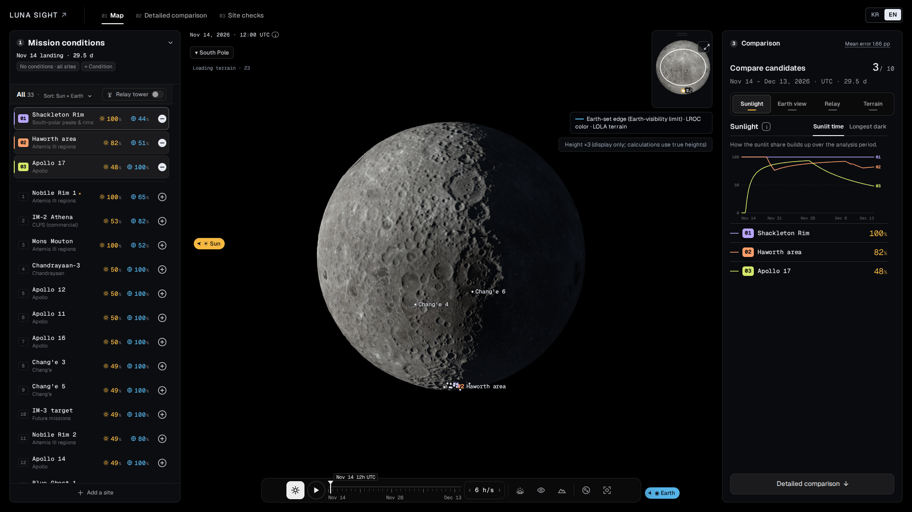
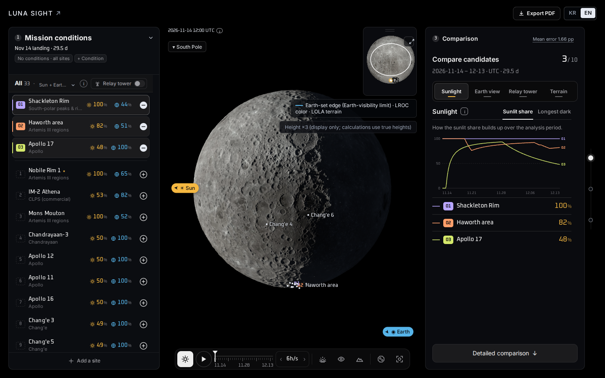
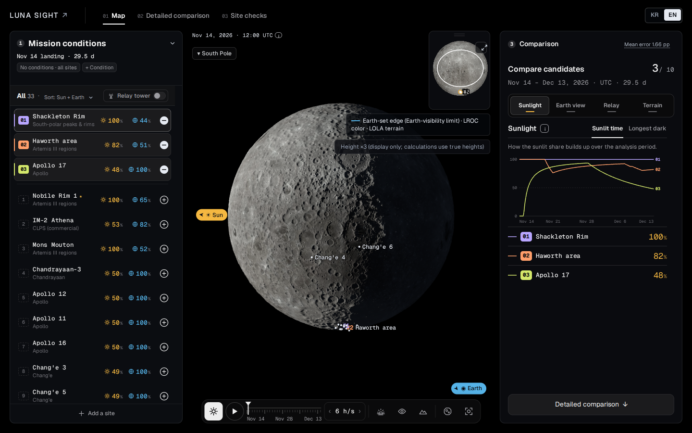
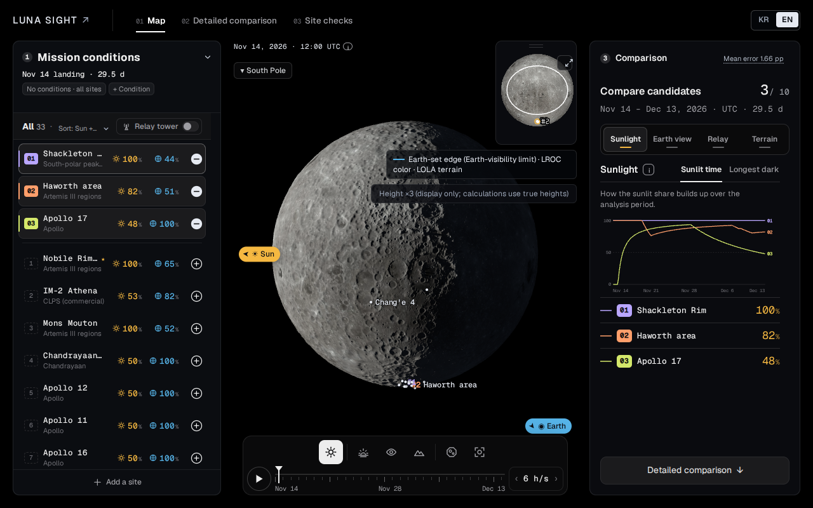
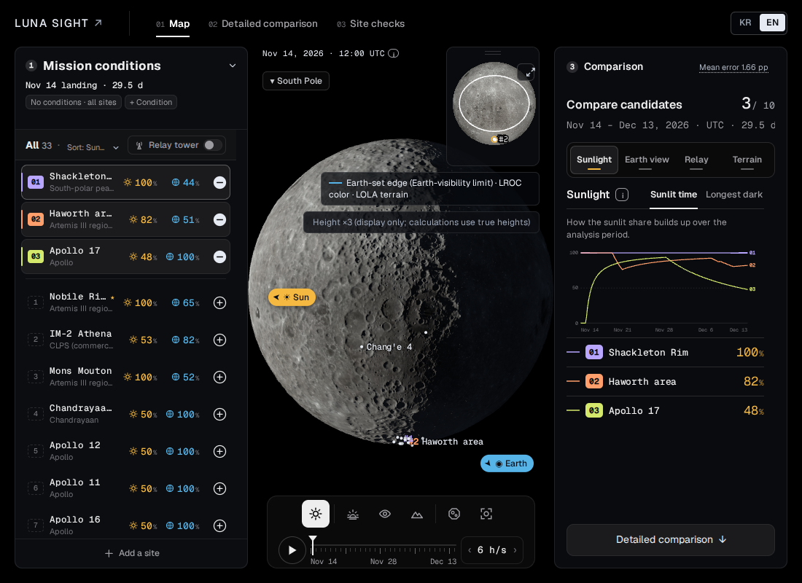
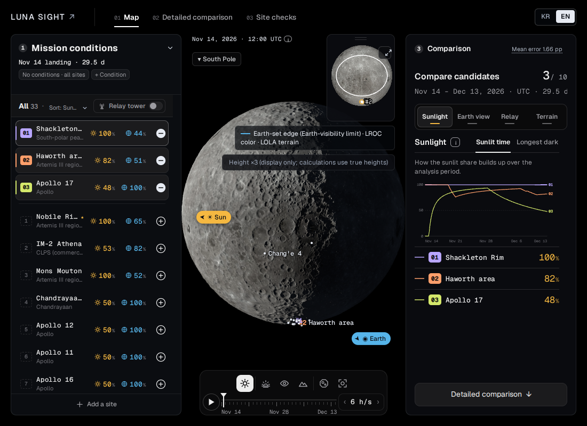
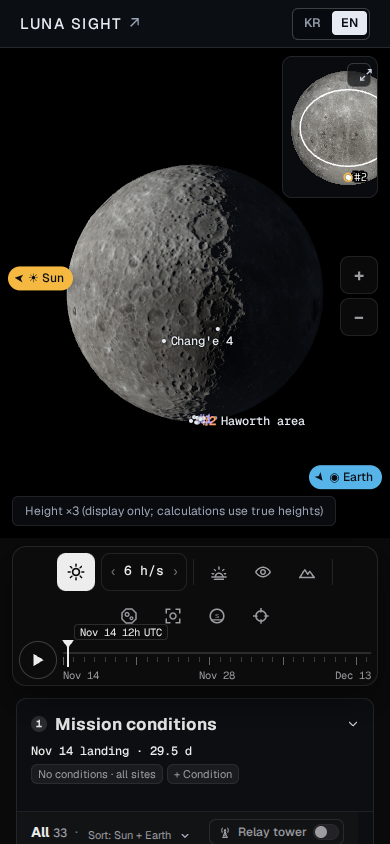
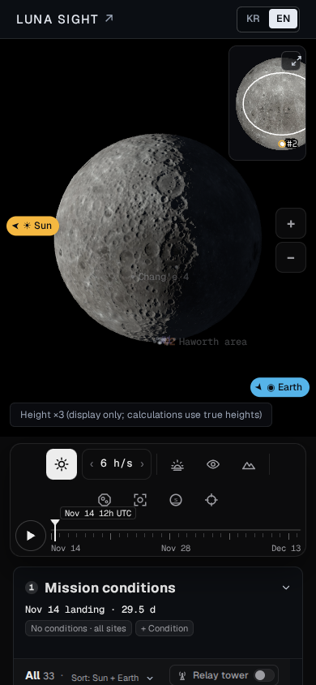

# Bundle 10 — dock width adaptation

Scope: desktop dock only (1920 / 1280 / 1100); inspect 1440, preserve the 390 px stacked layout, and check PR #97 tray integration. Minimap and legend changes were explicitly withdrawn by the requester and are excluded.

## Provenance

- Branch created from `s5-design-impl-sua` at `efd9a8667b3ad18178579ea214d642e4d219a60e`, then advanced to its descendant main.
- Integrated main: `9ce8b528d8e95018198e87df4132a8ca521c1646`.
- Runtime/test commit: `446adced1db1fb400f55268b8ec7cfbdf7e7f8ed`.
- Reference: `docs/design_sync/README.md`, bundle 10 in `채이사본_동기화_전수_1555.md`, and `shots/sync_full/A_1280_en_02_first.png`. Implemented from measurements and screenshots; no practice source read/copied.
- Browser run: https://github.com/kiisophii/lunar-landing-site-navigator/actions/runs/43702213208

## Implementation

Only production file changed: `web/css/layout.css`. Dock rules are restricted to desktop media queries. The 1920 px dock is capped at 800 px and 52 px high; two-row modes are 94 px / 85 px high; 1100 px buttons, including Play, are 32 px square. Row spacing at 1280 px is 4 px; 1100 px gap/padding are 3 px / 5 px. Existing bottom guide remains 20 px. The historical narrow-dock width reservation is kept after main's independent rail removal widened the map; dock centering follows the current map area.

No scientific calculations, data, minimap/legend selectors, or mobile rules were changed.

## Reproduction

```sh
npm install --no-save playwright
npx playwright install --with-deps chromium
python -m http.server 8788 --directory web
# In another terminal:
node verification/design_bundle10/check.mjs
```

The script serves the actual contest app, pins the baseline stylesheet via `git show`, captures before/after views, and checks console/page errors, document overflow, dimensions, control containment, data values, minimap/legend geometry, and mobile dock geometry. It also simulates PR #97 at its fixed reviewed SHA with request interception; the two snapshots under `verification/design_bundle10/pr97_tray.*` are test fixtures only and are never loaded by the production site.

## Final results

20 before/after captures (five widths × EN/KR × two states) and eight pinned PR #97 integration cases passed. Zero page/console errors and zero document horizontal overflow. Contest metric texts, minimap and legend rectangles, and the mobile dock rectangle are identical before/after.

| Viewport | EN dock | KR dock | Bottom |
|---|---|---|---|
| 1920 | 800 × 52 | 800 × 52 | 20 px |
| 1440 | 581 × 50 | 575 × 50 | 20 px |
| 1280 | 512 × 94 | 512 × 94 | 20 px |
| 1100 | 352 × 85 | 352 × 85 | 20 px |
| 390 | 366 × 140 | 366 × 140 | stacked, unchanged |

The 1440 px dock uses unchanged upstream sizing (581 px EN / 575 px KR); no 1440-specific sizing was requested. Main independently removed the 28 px rail, moving the map center 14 px to the right versus the historical reference. This PR preserves that current map centering; narrow dock widths remain 512 / 352 px.

## Tray tab check: superseded 54 px equal-cell target

PR #97 is still unmerged at verification time. The simulation pins `c147c21e5e747e9fca9fd41b4aa0629c0c2b9c9a`. Its newer 17:49 review explicitly replaces equal-width cells with label-proportional widths. Therefore **54 × 39 is not the current uniform-cell result**. All eight cases retain 39 px height, no overflow/errors. The production tray is not changed in this PR.

| Width | Tab widths (px, EN and KR) | Height |
|---|---|---|
| 1920 | 76.73 / 88.69 / 60.80 / 67.78 | 39 |
| 1440 | 76.73 / 88.69 / 60.80 / 67.78 | 39 |
| 1280 | 64.20 / 74.22 / 50.86 / 56.72 | 39 |
| 1100 | 61.06 / 70.61 / 48.38 / 53.95 | 39 |

## Failure retained

The first current-main run exposed an English-only third row: localized `6 h/s` is wider than the Korean label, so a fixed reserved width let speed controls wrap and pushed the top buttons outside the dock. See `initial_failure.json` and [failed run](https://github.com/kiisophii/lunar-landing-site-navigator/actions/runs/43701647591). The final fix lets the time block grow into the available second-row space and shrink beside the speed control. Speed buttons are included in final containment assertions. The final run has zero failures; the failure record has not been removed.

## Before / after screenshots

Full EN/KR captures and metrics are in this directory. The visible numbers are repository calculations, not copied from the reference.

### 1920 px, English

Before:


After:



### 1440 px, English

Before:



After:



### 1280 px, English

Before:


After:



### 1100 px, English

Before:



After:



### 390 px, English

Before:



After:



## Concurrent-main integration follow-up

After the screenshot run, main `e40961f9baec3bd564a937886f521fe5f8c13edc` added the independent Site check bundle and reformatted/appended the SI log. Integrated that commit and preserved every existing SI row byte-for-byte before appending our row. No dock or minimap/legend production changes were introduced by that integration. A [separate smoke run](https://github.com/kiisophii/lunar-landing-site-navigator/actions/runs/43702981292) at `0c6272aab97625222ca5589d533d6475f132fb63` rechecked all 10 viewport/language configurations: zero errors/overflow, exact requested dock sizes, and all visible controls inside the desktop dock. Result: `integration-smoke.json`. Full before/after capture test remains separately reproducible with `check.mjs`; CI now executes the integration smoke script.

## 1280 English sub-tab follow-up

[Follow-up report](subtabs/README.md): 14px inline headings across all four categories, unchanged 1440 EN/KR, no internal/document horizontal overflow. Same branch and PR #117.
