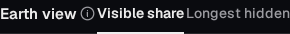
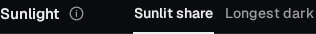

# Follow-up: 1280 English inline sub-tabs

- Baseline: `58bbc449692185698f2d9eb6a2d52cb2a4707293`.
- Fix/test commit: `5e5c383160112100e377bf0212584259669597c3`.
- [Passing browser run](https://github.com/kiisophii/lunar-landing-site-navigator/actions/runs/43704438587).
- Request: keep 1280 English sub-tabs to the right of the heading, retain 14px text, preserve 1440 EN/KR. Same branch / PR #117.

## Scope and implementation

All new production rules are restricted to `html:lang(en)` inside the **1280–1439 px** media query. The category heading does not wrap; heading/sub-tab gaps are 2px, sub-tab button padding is zero, and font size remains 14px. The info glyph is retained with a compact 16px outer width. The heading uses 290px at 1280. Scroll padding and body/description margins compensate for the heading's extra width; the pinned PR #97 chart/body width stays unchanged. No 1440 rules, calculations, data, minimap or dock behavior were edited.

## Results

64 before/after states: production and pinned PR #97, 1280/1440, EN/KR, Sunlight/Earth/Relay/Terrain. **Zero failures, page/console errors, document overflow or internal horizontal overflow.** All 16 1440 category/language/mode comparisons have identical before/after metrics. Contest values are unchanged.

| 1280 EN, PR #97 | Heading width | Sub-tab font | Horizontal scroll |
|---|---|---|---|
| sun | 290px | 14px | 0px |
| earth | 290px | 14px | 0px |
| relay | 290px | 14px | 0px |
| terrain | 290px | 14px | 0px |

## Screenshots

1280 EN Sunlight, final:


1280 EN Earth, final (longest labels):


1440 EN before / after (full capture from the preceding run; final-run metrics reverified unchanged):



1440 KR before / after:


## Reproduction and retained failures

```sh
python -m http.server 8788 --directory web
# Another terminal, with Playwright/Chromium installed:
BASELINE=58bbc449692185698f2d9eb6a2d52cb2a4707293 node verification/design_bundle10/subtabs.mjs
```

`checks.json` contains all rectangles, fonts, scroll/client widths and values. `initial_failure.json` records the long Earth labels exceeding the header; `scroll_failure.json` records the intermediate internal overflow. Both were fixed, not suppressed. The final test explicitly checks the scroller as well as the document. The existing fixed-head PR #97 snapshots are test fixtures, not production code.
