# Bundle 8 — comparison tray design sync

Implemented from the bundle-8 measurements and the reference PNG only. No practice HTML/CSS/JS was read or copied. Base main: be9aeab5b18fbe3d8e86c6295b8af9e5247c8ce2. Runtime scope: web/css/layout.css (appended bundle-8 selectors) and web/js/tray_cat.js (chart viewport dimensions and footer SVG only). No index.html, calculation, data, picker logic or other members' page modules changed. Shared information-icon glyphs are the one intentional cross-panel visual rule specified by item 8-6; existing labels, tooltips and enlarged hit areas remain.

## Delivered

- 8-1: header, title, period, tabs and scrolling content share the reference right edge; scrollbar sits outside the content line.
- 8-2: reference spacing: header top 81, period top 176.69, tabs top 214.83 at the 1440 viewport. Candidate heading text occupies the reference y144 line (its line box starts at 139.69).
- 8-3: tabs 73.5x39 at 1440, 54x39 at 1280 (bundle 10-4's explicit narrow target).
- 8-4: chart 301x100 at 1440; 100px high and width-responsive at 1280. Only drawing dimensions changed, not series calculations.
- 8-5: candidate rows 42px minimum.
- 8-6: circular 15px information glyph, 1.25px stroke, #9C9CA1; category info button 22x22.
- 8-7: unboxed mean-error badge, padding 2px 0, actual contest error value retained.
- 8-8: 16px SVG downward arrow in the detailed-comparison footer.
- Reference sub-tabs occupy a separate line beneath the category heading. Existing two computed sub-views per category are retained; no practice values or new metrics introduced.

## Verification

Playwright Chromium full application, reduced motion, same fixed catalogue/date/period/time for before and after. Baseline CSS and tray module are read from the pinned contest commit, not the practice board. All 4 categories and both existing sub-views exercised. Before/after display-value equality asserted. 12 captures (6 screen/language combinations x before/after), plus tray crops. Exact metrics and errors: [checks.json](checks.json); test outcome: [result.json](result.json).

Final run: https://github.com/kiisophii/lunar-landing-site-navigator/actions/runs/43695312827
Reproduce after npm install playwright / npx playwright install chromium: serve web/ at port 8788 and run node verification/design_bundle8/check.mjs from the repository root.

|Width|Language|Content width|Chart|Row height|Tab width|Console/page errors|Page horizontal overflow|
|---|---|---:|---|---:|---:|---:|---|
|1920|en|316|301 x 100|42|73.5|0|None|
|1920|ko|316|301 x 100|42|73.5|0|None|
|1440|en|316|301 x 100|42|73.5|0|None|
|1440|ko|316|301 x 100|42|73.5|0|None|
|1280|en|238|223 x 100|42|54|0|None|
|1280|ko|238|223 x 100|42|54|0|None|

## Before / after screenshots

### 1920 EN

|Before|After|
|---|---|
|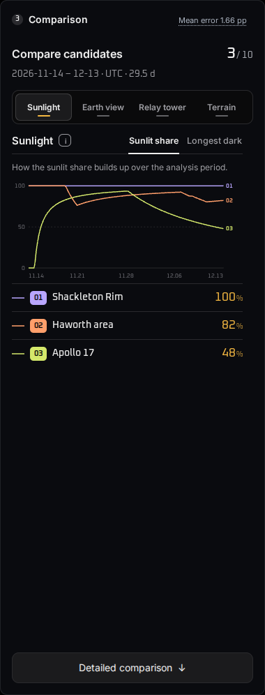|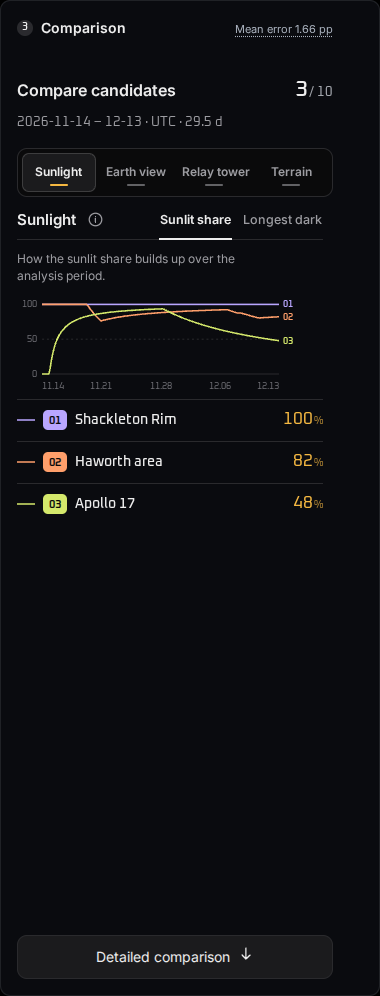|

[Full before](before_1920_en.png) · [Full after](after_1920_en.png)

### 1920 KO

|Before|After|
|---|---|
|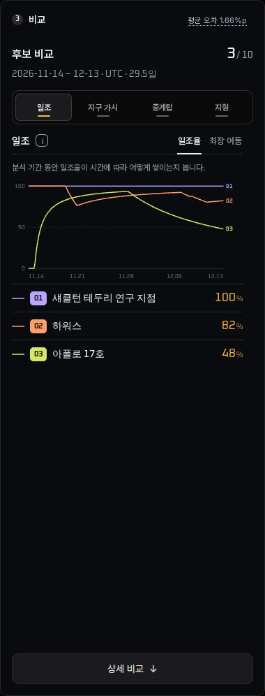|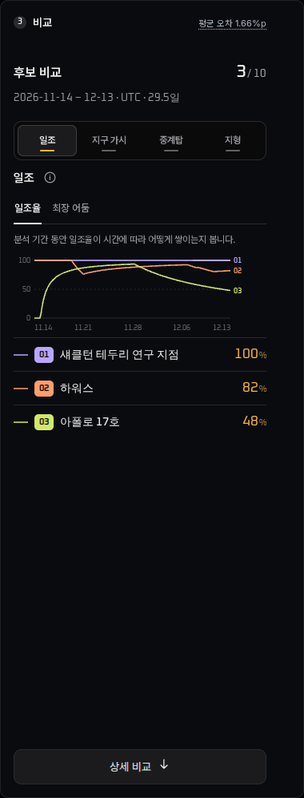|

[Full before](before_1920_ko.png) · [Full after](after_1920_ko.png)

### 1440 EN

|Before|After|
|---|---|
|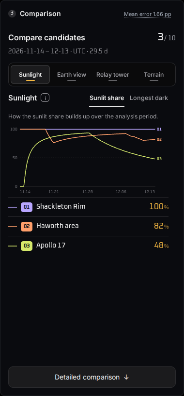|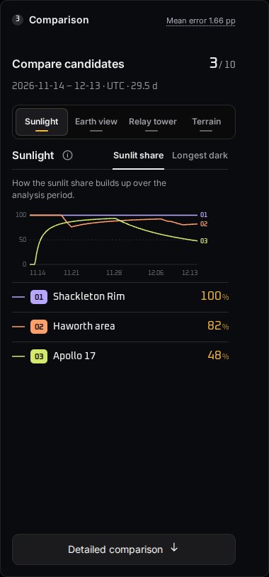|

[Full before](before_1440_en.png) · [Full after](after_1440_en.png)

### 1440 KO

|Before|After|
|---|---|
|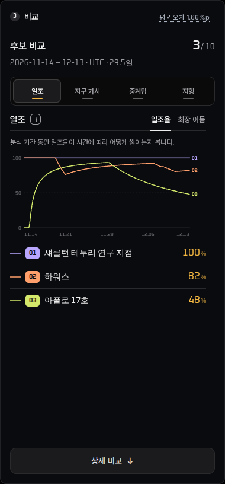|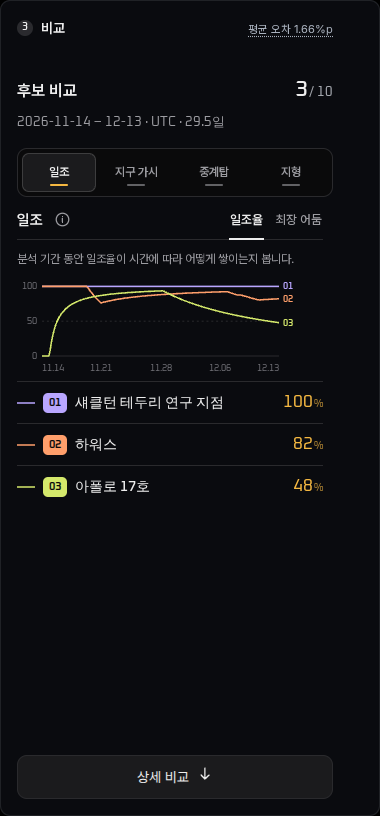|

[Full before](before_1440_ko.png) · [Full after](after_1440_ko.png)

### 1280 EN

|Before|After|
|---|---|
|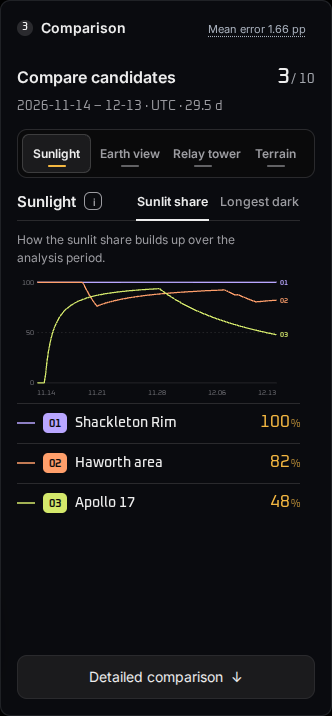|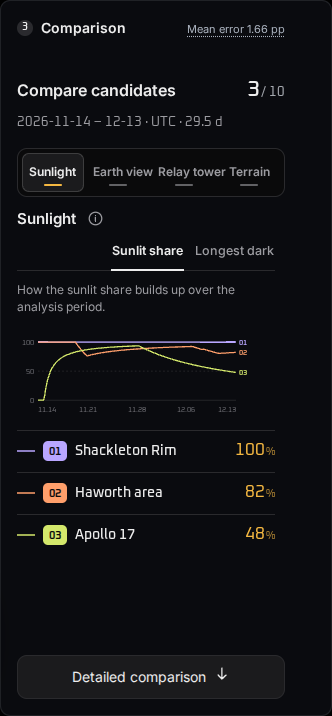|

[Full before](before_1280_en.png) · [Full after](after_1280_en.png)

### 1280 KO

|Before|After|
|---|---|
|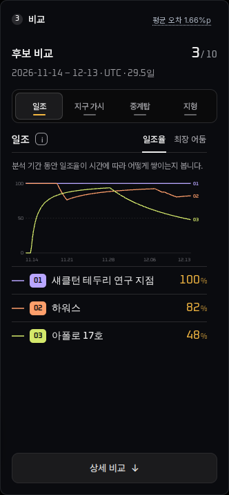|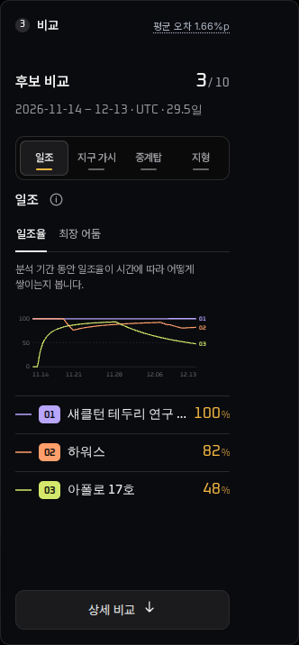|

[Full before](before_1280_ko.png) · [Full after](after_1280_ko.png)

## Limits

Reference A uses different pinned sites and practice data; its numeric values and site selection were deliberately not copied. Full screenshots include the unchanged contest first-screen panels and globe, owned by other bundles; this PR claims bundle 8 measurements, not a pixel-perfect match of the entire app. Automated checks cover desktop Chromium at the requested sizes; they do not assert Safari/mobile browser execution. The existing stacked mobile layout is not replaced. Earlier preliminary CI runs are superseded by the final run linked above.
