# PR #97 follow-up — designer reference at 17:49

This supersedes the earlier equal-width tabs, separate sub-tab line and narrow 54px-tab target in the initial bundle-8 report. Implemented from the user's four review points; no practice code was copied. Baseline for these before/after captures: PR head 9217c2b32b9e24f3d40b3c51b4428053267793fa. Scientific inputs and calculations unchanged.

## Review resolution (1440 EN)

|Request|Measured after|
|---|---|
|Label-sized tab widths 77 / 89 / 61 / 68 px|76.734 / 88.688 / 60.797 / 67.781 px (round to requested values); compact Relay tab, full category heading retained|
|Sub-tabs on the heading line, right aligned, 14px|14px; category and sub-tabs share the same flex line|
|Candidate rows 301px, swatch 24x6, grey percent values|301px; 24x6; rgb(156,156,161), #9C9CA1|
|Check mean-error badge|Visible in baseline and after in all six combinations; actual data-driven Mean error 1.66 pp / 평균 오차 1.66%p; popover opened/closed and captured|

Badge absence reported in the review was not reproduced in this checkout. The existing trust.js module and validation data supply it; explicit layout/visibility styling was added, without inventing a fallback statistic. See the badge captures below.

An additional 3px focus-induced horizontal shift of the outer tray after repeated tab changes was found and fixed: the outer flex layout now clips rather than becoming a hidden scroll container; the inner tc-scroll remains the vertical scroller.

## Final verification

Run: https://github.com/kiisophii/lunar-landing-site-navigator/actions/runs/43699724379

1920x1080, 1440x900, 1280x800 x EN/KR; all four categories and existing sub-views, language changes, badge/popover, unchanged displayed values. Zero console/page errors, zero page horizontal overflow, zero internal horizontal drift in all final cases. Full machine measurements: [checks.json](checks.json), [result.json](result.json). Narrow panels retain responsive wrapping when a full 14px English sub-tab pair cannot fit; at 1440/1920 both languages are inline. At 1280 candidate/chart width shrinks with the panel; it remains 301px at the review's 1440 target.

|Width|Language|Row/chart width|Sub-tab font|Errors|Internal drift|Badge|
|---|---|---:|---|---:|---:|---|
|1920|en|301|14px|0|0|Mean error 1.66 pp|
|1920|ko|301|14px|0|0|평균 오차 1.66%p|
|1440|en|301|14px|0|0|Mean error 1.66 pp|
|1440|ko|301|14px|0|0|평균 오차 1.66%p|
|1280|en|253|14px|0|0|Mean error 1.66 pp|
|1280|ko|253|14px|0|0|평균 오차 1.66%p|

## Screenshots

### 1920 EN

|Before review fixes|After review fixes|
|---|---|
|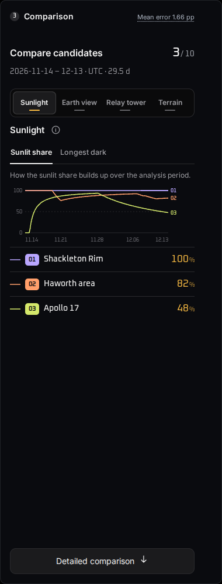|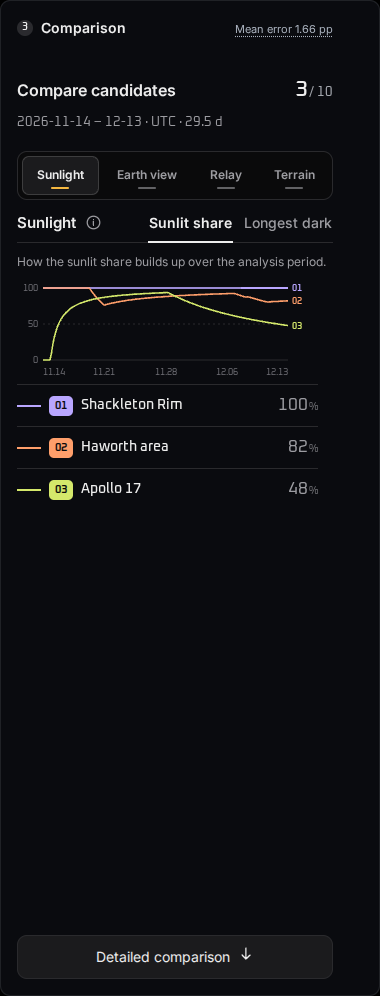|

[Full before](before_1920_en.png) · [Full after](after_1920_en.png) · [Badge and open explanation](after_1920_en_badge.png)

### 1920 KO

|Before review fixes|After review fixes|
|---|---|
|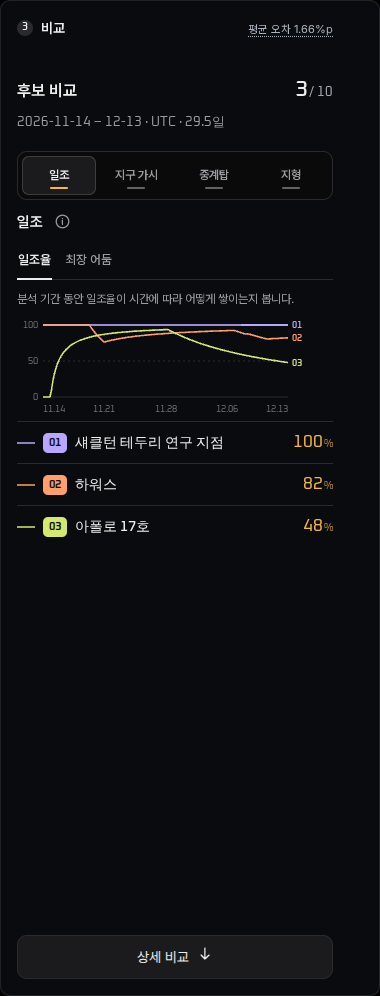|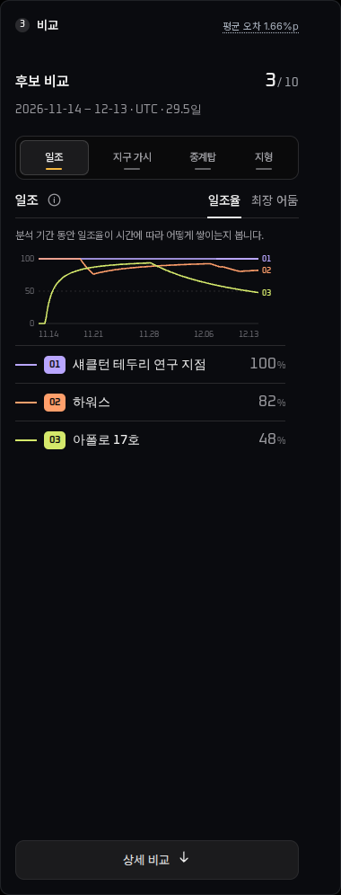|

[Full before](before_1920_ko.png) · [Full after](after_1920_ko.png) · [Badge and open explanation](after_1920_ko_badge.png)

### 1440 EN

|Before review fixes|After review fixes|
|---|---|
|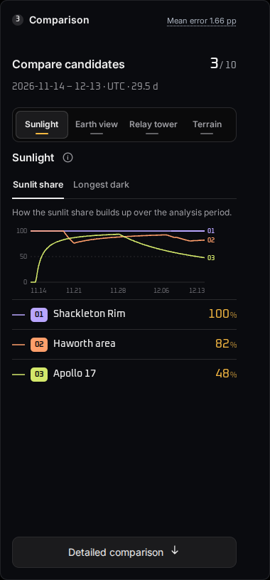|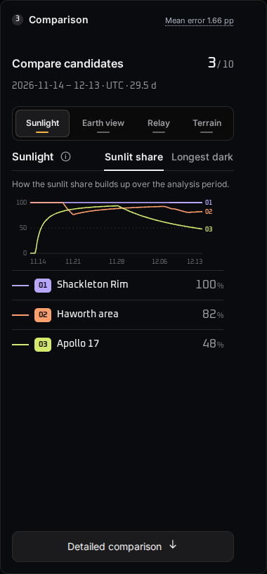|

[Full before](before_1440_en.png) · [Full after](after_1440_en.png) · [Badge and open explanation](after_1440_en_badge.png)

### 1440 KO

|Before review fixes|After review fixes|
|---|---|
|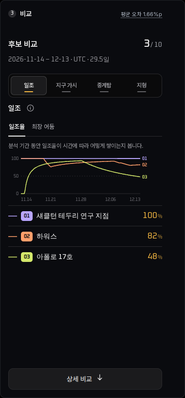|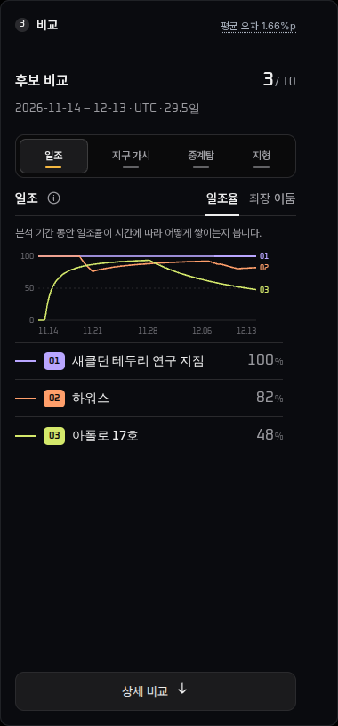|

[Full before](before_1440_ko.png) · [Full after](after_1440_ko.png) · [Badge and open explanation](after_1440_ko_badge.png)

### 1280 EN

|Before review fixes|After review fixes|
|---|---|
|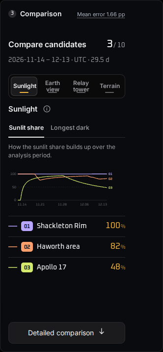|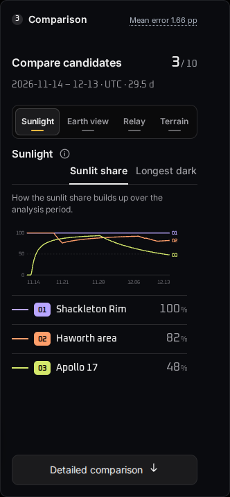|

[Full before](before_1280_en.png) · [Full after](after_1280_en.png) · [Badge and open explanation](after_1280_en_badge.png)

### 1280 KO

|Before review fixes|After review fixes|
|---|---|
|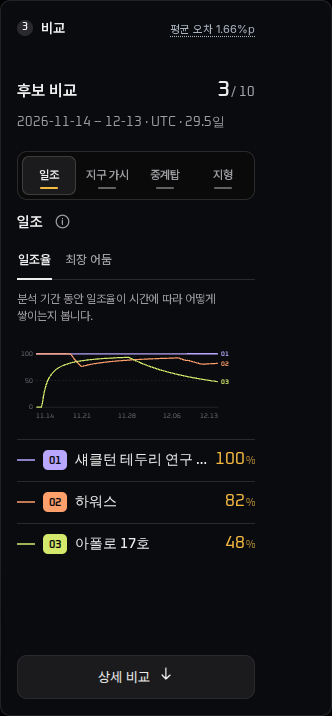|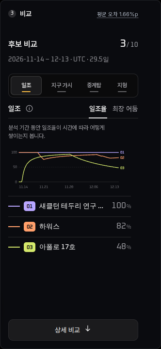|

[Full before](before_1280_ko.png) · [Full after](after_1280_ko.png) · [Badge and open explanation](after_1280_ko_badge.png)

