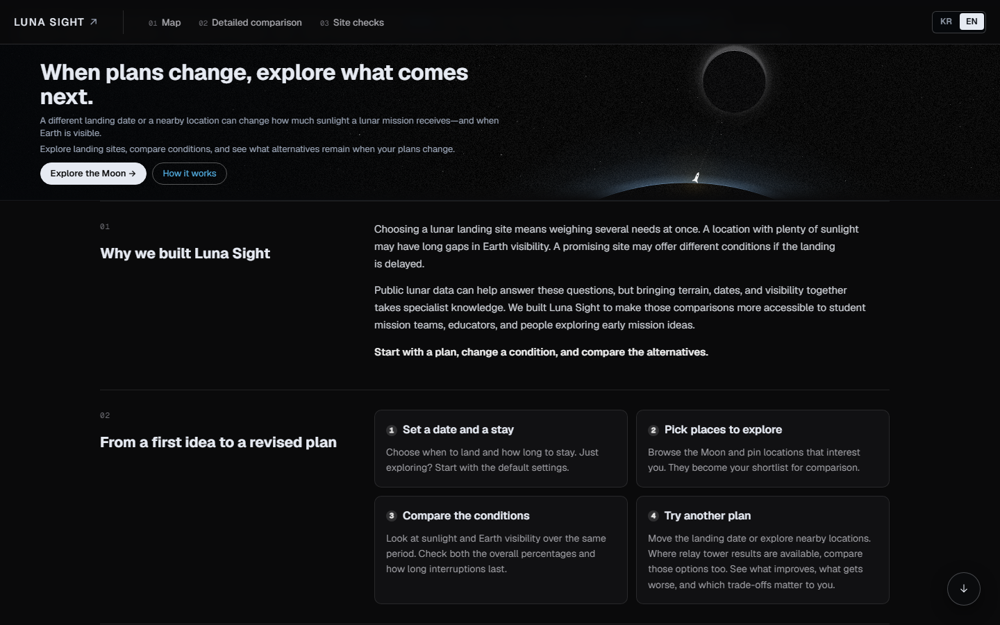
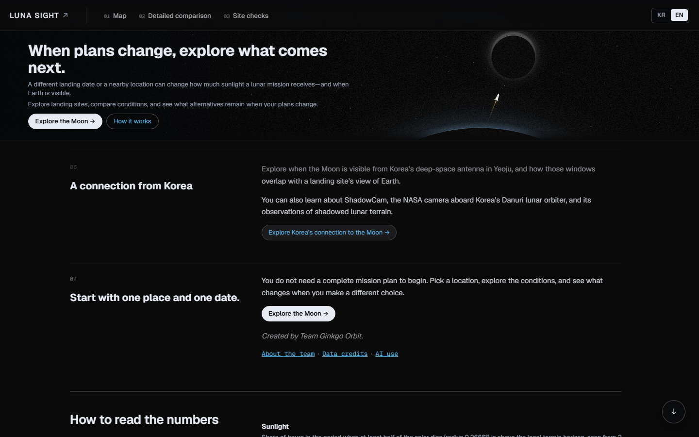
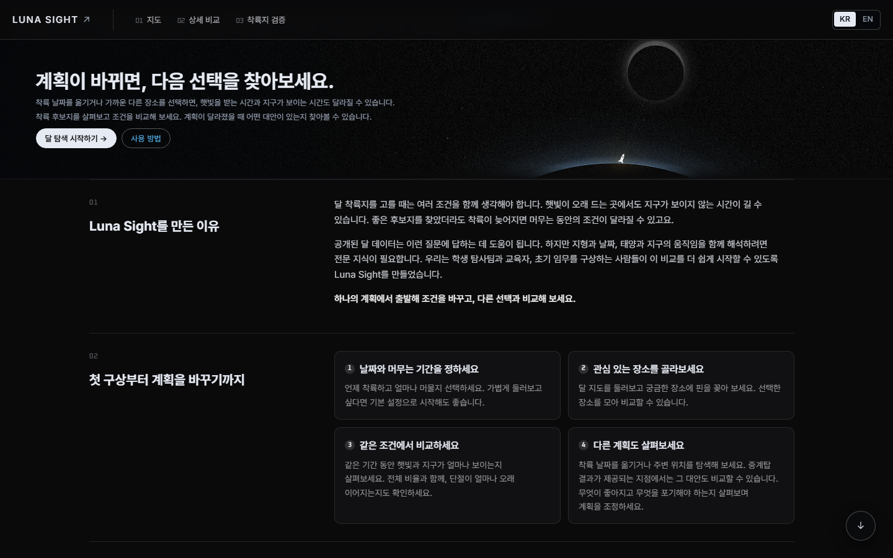
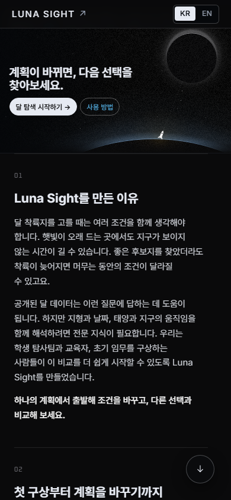

# About: original journey in a 25% band

Jiyong; base 490c024, integrated and revalidated against main 9ce8b52 (new team wording, credits, navigation and styles preserved). User-supplied `luna-sight-About상단 인터렉션.zip`, `about-journey.js` and its accompanying prompt are the source. Original renderer SHA-256: `2fcf5d8a3745a6e73341ce340ccdaa1ea0b4ac9ca6091f58c1244d108a3f953f`.

The user's later instruction supersedes the prompt's 40% desktop / 30% mobile sizing: the band is 25dvh at every width. To keep the illustration legible, the original craft height is 40 virtual units (was 32), Moon radius 115 (was 100), padding 20/65, focus 72% desktop / 78% mobile. All dependent path/landing geometry uses those sizes. Earth stays visible along the lower edge. The original canvas renderer replaces the prior SVG reconstruction; the adapter drives its supplied timeline with the prompt's 12% interpolation and final 15% hold.

`#abScroll` contains the existing body markup unchanged. Team copy in `about_copy.js` is unchanged, including both hero action labels. The old eyebrow and decorative caption are removed as requested by the prompt. On small screens the lead is hidden as in the prompt; it remains in the DOM. Header height is measured so the band is never covered by the desktop header. The scene is destroyed while About is hidden and recreated on return; rerenders dispose their old renderer. Reduced motion goes to the landed pose without grain/star movement.

The fade applies only after scrolling. The arrow advances to the next direct child section at a 32 px offset, reaches the bottom, then becomes Back to top / 맨 위로. Internal links and details remain functional. Scientific computation, main view and index.html are unchanged.

## Frames

| Start | In flight |
|---|---|
|  |  |

| Desktop Korean | Mobile Korean |
|---|---|
|  |  |

## Verification

With a static server serving web/ at http://127.0.0.1:8020 and JavaScript MIME type text/javascript:

```
python pipeline/verify_about_band.py
python pipeline/verify_about_band_content.py
node --check web/js/about_hero.js
node --check web/js/about.js
node --check web/js/shell.js
git diff --check
```

Chromium: 1440×900, 1024×768, 390×844. Checks cover exact 25% height, text bounds, header clearance, no horizontal overflow, internal scrolling, fade, next/back arrow, routing cleanup/re-entry, EN/KO, resize, How it works link and console errors. Normal-motion screenshots cover progress 0, .35, .6, 1. Content check compares all lower-section markup against the base and verifies no team-copy diff. Tests use one foreground page at a time because intentionally backgrounded pages stop their renderer.
