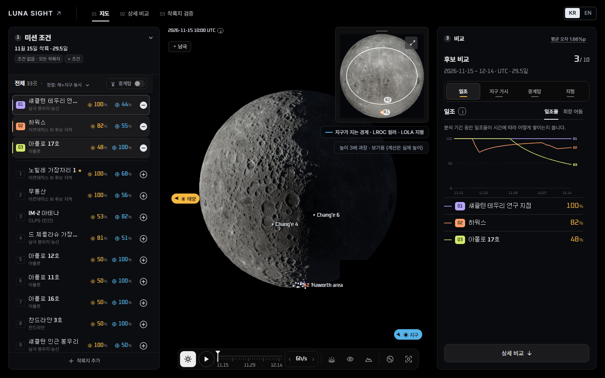
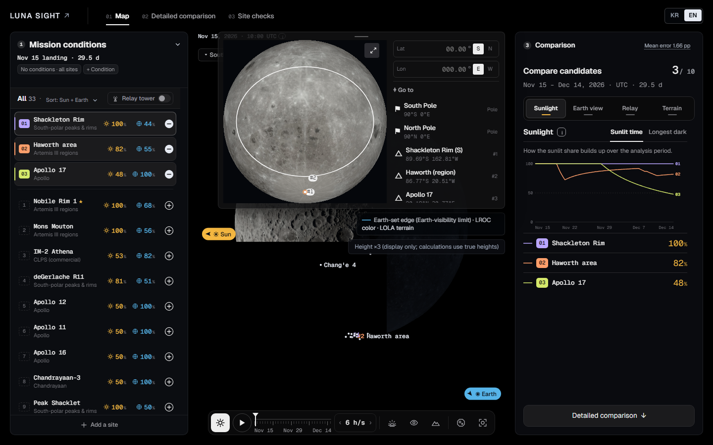
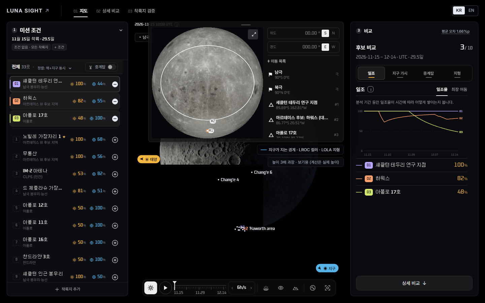
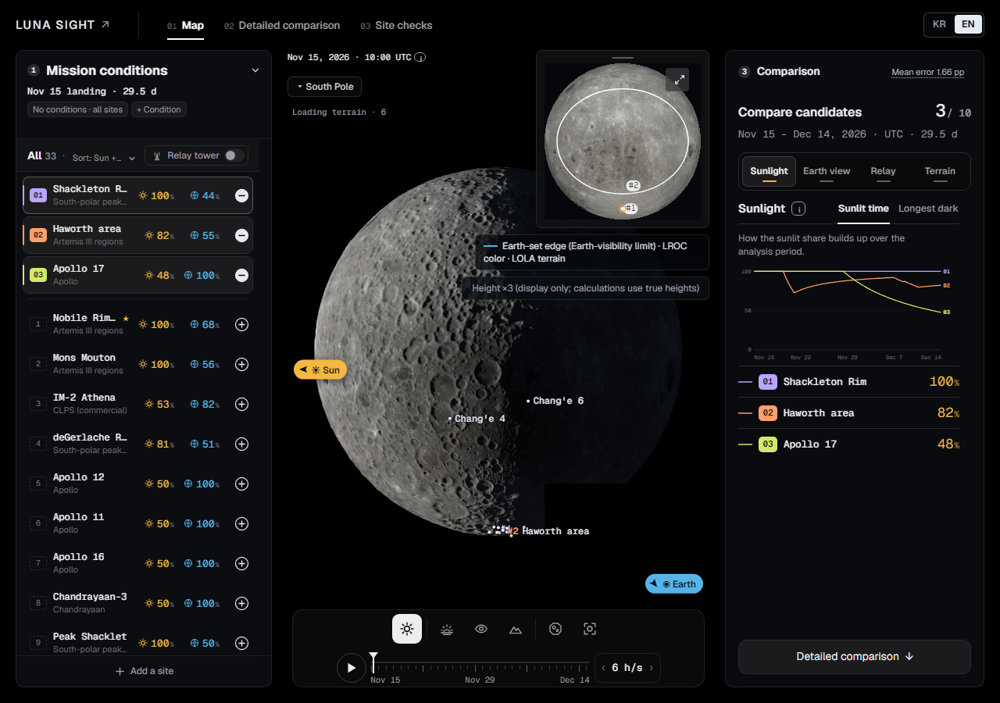
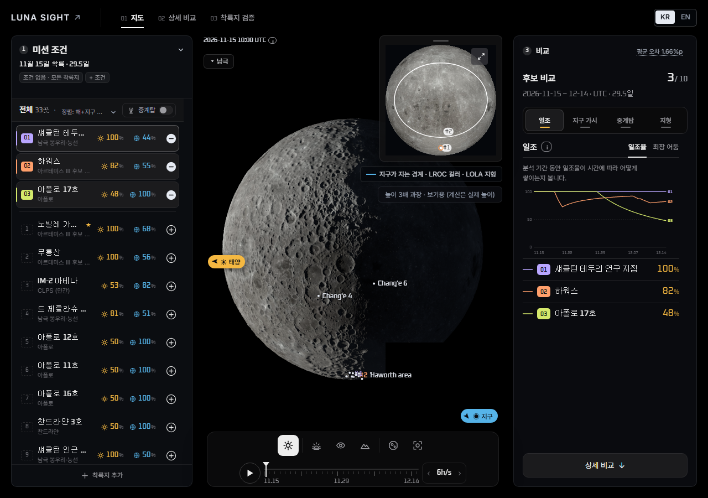
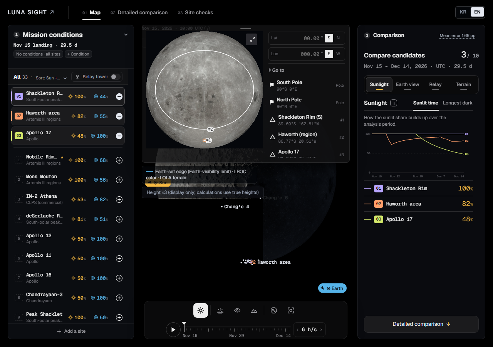
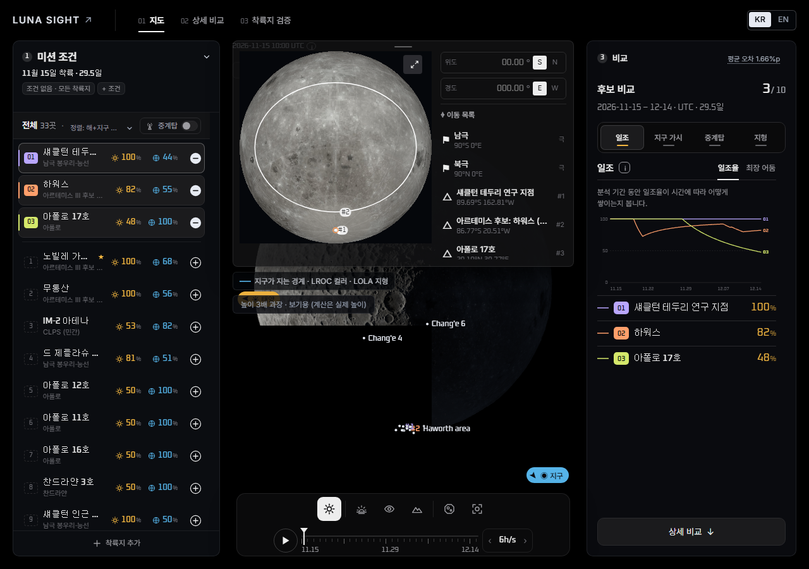

# Minimap bundle 13 — Jiyong

Base: main v45 (`e40961f`). Source: the supplied Chaei 18:41 specification, [bundle 13 excerpt](reference_bundle13.md). This supersedes the earlier small minimap design.

- 1440: closed 222×228 at (798,64), 200×200 globe; expanded 580×358 at (440,64), 330×330 globe. Top-right anchor stays fixed, opening left/down with 260 ms size/position/shadow transitions. Reduced motion removes transitions.
- 1280: closed dimensions unchanged; expanded width clamps to the available 540 px map area instead of overlapping adjacent panels. Stored preferred width remains 580 px.
- Separate latitude/longitude magnitudes, S/N and E/W buttons, Enter to navigate, validation and existing optional point analysis. Go to lists both poles, pinned/current leading candidates and past landing groups from the production catalogue. No reference coordinates are substituted.
- Grip movement, arrows (10 px; Shift 40 px), Home/double-click reset, corner snapping and position storage remain. Eight edge/corner handles support pointer and keyboard resizing; closed/open dimensions persist independently and stay within the map area. Storage failures are nonfatal.
- Faint graticule, separate white pinned-number pills, orange focus ring and selected-coordinate star. Legends follow the box at 8 px spacing; if the lower map edge has no room, they move above it.
- Initialization is explicitly synchronized so a late minimap build cannot erase the grip/resize handles.

Production changes are limited to `web/js/minimap.js`, `web/js/minimap_drag.js`, and a minimap-scoped block in `web/css/layout.css`. No changes to index.html, other first-screen styling, science code or datasets.

## Screenshots

| View | English | Korean |
|---|---|---|
| 1440 closed |  |  |
| 1440 expanded |  |  |
| 1280 closed |  |  |
| 1280 expanded |  |  |

## Verification

Run a static server from web/ on port 8020 with `.js` served as `text/javascript`, then:

```
python pipeline/verify_minimap13.py
python pipeline/verify_minimap13_edges.py
node --check web/js/minimap.js
node --check web/js/minimap_drag.js
git diff --check
```

The browser loads the real app and waits for its 3D globe. Navigation tests capture the `flyTo` arguments without rendering each long-distance flight; these verify the minimap's coordinate/sign and destination wiring, not the unchanged 3D flight engine. Other interactions use actual browser pointer/keyboard input. Each language/width checks all eight resize handles, separate persisted sizes after reload, coordinate limits/hemispheres, destination selection, Escape and arrow/Home movement, and document overflow. `checks.json` and `verification.log` record results; no page or console errors are allowed.

Fresh review found a reversed-size movement edge case (closed larger than open). Placement now normalizes against the current mode and preserves the upper-right expansion anchor separately. The extra browser check also verifies normal-motion intermediate dimensions, pointer movement, double-click reset and full left/bottom reach with reversed saved sizes; see `motion_check.json`.
