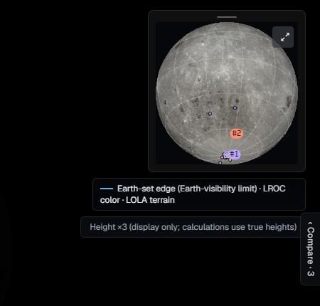
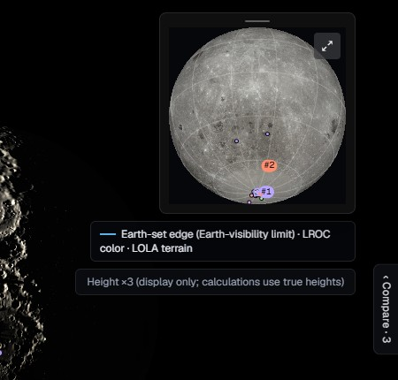
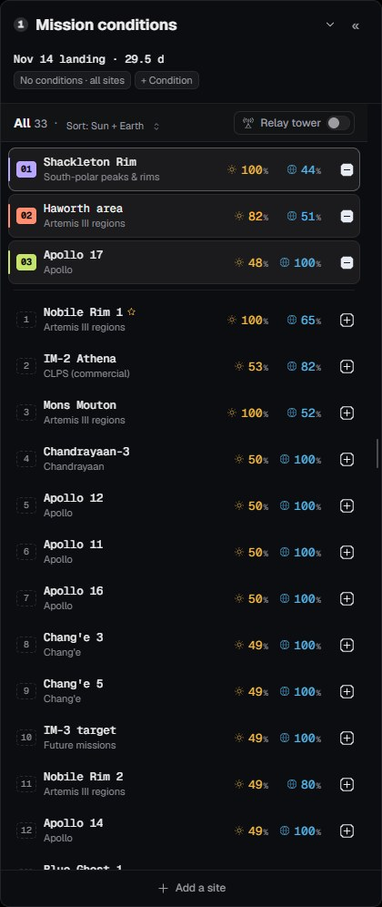
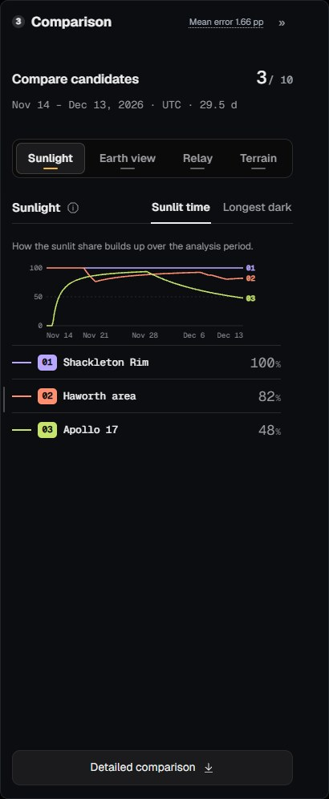
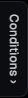
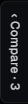
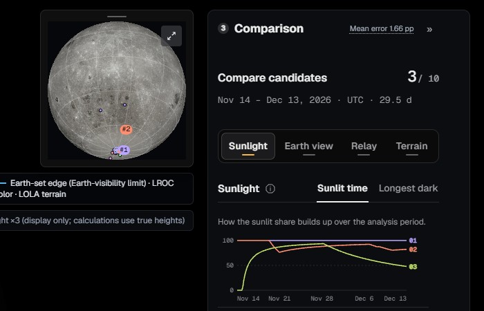

# Side-card resize, folded labels and map alignment

Started from main/v47 1695230, advanced to integ-1915 13010bc, then integrated target 58a9a48 and repeated the full matrix. Existing dock, legend and integration changes are preserved.

## Changes

- Drag the inside edge of either card to resize it; keyboard arrows adjust 10px (Shift: 30px), Home or double-click resets. Widths persist across reloads. Limits: left 280px, right 300px, maximum 560px; at least 344px remains for the map. Narrow screens constrain resizing to available space.
- Folded Conditions / Compare labels size to their complete text.
- The minimap uses logical map boundaries, reserves the 28px reopen tab and recalculates after panel transform transitionend/cancel and layout changes. Height notes clear the reopen tab.
- 3D camera view offsets update even when the canvas dimensions do not change. Both folded edges and resized card widths contribute to the map centre.

Production changes: layout.css (side-card rules only), panels_layout.js, modules.json, minimap_drag.js, globe_app.js and globe3d.js. No index, dock, legend, data or scientific calculation edits.

## Validation

Actual Chrome, original cached CDN fonts and Three.js 0.170 renderer; application data and camera are not mocked. 1920x1080, 1440x900, 1280x800 and 1100x800, EN/KR. Three repeats of left/right/both folds, rapid reopen on both sides, persisted collapsed-left reload and one-click reopening, explicit expected open/closed state assertions, real pointer grow/shrink, Home reset; waits for completed animations. Measures minimap bounds, note/tab overlap, restored geometry, entire label ink bounds, actual camera projection and document overflow. Full matrix: 8 cases / 256 observed states. Extra keyboard / saved-width reload / folded-label test: 13 states. Zero assertion failures, console/page errors or failed requests. The reported left first-click error was not reproduced on this fixed branch; explicit one-click state assertions and saved-fold reload cases are included rather than claiming an unobserved error cause.

| Width | Language | States | Left: original/grow/shrink/reset | Right: original/grow/shrink/reset |
|---|---|---|---|---|
| 1920 | en | 32 | 360/384/336/360 | 380/404/356/380 |
| 1920 | ko | 32 | 360/384/336/360 | 380/404/356/380 |
| 1440 | en | 32 | 360/384/336/360 | 380/404/356/380 |
| 1440 | ko | 32 | 360/384/336/360 | 380/404/356/380 |
| 1280 | en | 32 | 328/352/304/328 | 332/356/308/332 |
| 1280 | ko | 32 | 328/352/304/328 | 332/356/308/332 |
| 1100 | en | 32 | 320/344/296/320 | 320/344/300/320 |
| 1100 | ko | 32 | 320/344/296/320 | 320/344/300/320 |

Raw matrix and persistence observations are in the gzipped JSON files; summary.json and result.json are readable results. Original pre-fix minimap observations remain in checks.json.gz: the 28px boundary and height-note overlap failures were reproduced; stale restoration is timing-dependent and did not occur in every before run.

## Screenshots

1280 EN folded right:

Resized cards:

Entire folded labels:

1920 restored:

## Reproduce

    npm install --prefix verification/minimap_panels --no-save playwright
    pwsh -File verification/v46_tray_dock/prepare-cache.ps1
    $env:QA_CACHE = (Resolve-Path verification/v46_tray_dock/.cache).Path
    node verification/minimap_panels/check.cjs
    node verification/minimap_panels/persistence.cjs

QA_CACHE is optional with normal CDN access. CHROME_PATH, REPO_ROOT and QA_OUT optionally override paths. Portable copies change environment paths only. Original vendor sources: https://fonts.googleapis.com/ ; https://cdn.jsdelivr.net/gh/orioncactus/pretendard@v1.3.9/ ; https://cdnjs.cloudflare.com/ajax/libs/three.js/0.170.0/three.module.min.js . Cache binaries are not committed.

## Additional left-card report

The internal mission editor was tested separately from the outer panel: in all eight configurations, + Condition opens on the first click, Done closes, and the title toggle opens/closes, repeated three times (48 successful opening actions). No page/console/request errors. See conditions-open.json. The originally reported first-click error was not reproduced, so no speculative shell change is included.

    node verification/minimap_panels/conditions.cjs
