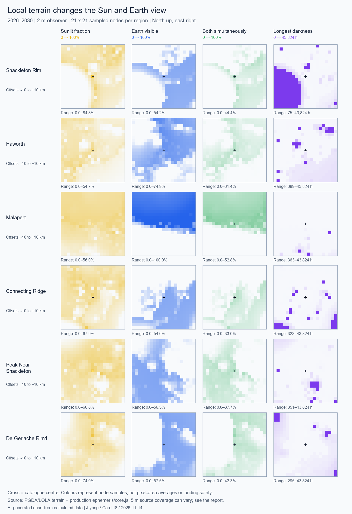

# Card 18 — local location sensitivity

Owner: Jiyong. Computed 2026-11-14.

Six 21×21 grids, ±10 km east/north at 1 km spacing (2,646 nodes). All results use the actual production core.js over 43,824 hourly samples, 2026–2030. Earth visibility is geometric direct-to-Earth visibility, not station availability or guaranteed radio service.

Plot: `python pipeline/plot_local_maps.py`. Each square represents a sampled node; all regions share each metric's colour scale.

## Nearby contrasts useful for the Impact story

These pairs are adjacent grid nodes, approximately 1 km apart. Selection maximises the difference within each sampled region; it is not a representative average or an uncertainty bound. Coordinates and all source hashes are retained in location_sensitivity.json.

| Region | Metric | Separation km | Values | Difference pp | East/north offsets km | Ground DEM m (A/B) |
| --- | --- | --- | --- | --- | --- | --- |
| SHACKLETON_RIM | sun_frac | 1.000 | 0.28% → 59.23% | 58.94 | (8,8) → (7,8) | 5/5 |
| SHACKLETON_RIM | earth_frac | 1.000 | 0.00% → 54.18% | 54.18 | (8,7) → (8,6) | 5/5 |
| SHACKLETON_RIM | both_frac | 1.000 | 0.00% → 44.36% | 44.36 | (0,1) → (0,0) | 5/5 |
| ARTEMIS_HAWORTH | sun_frac | 1.000 | 2.33% → 42.61% | 40.28 | (-1,-2) → (-1,-1) | 5/5 |
| ARTEMIS_HAWORTH | earth_frac | 1.000 | 0.28% → 74.95% | 74.67 | (-3,9) → (-3,10) | 5/10 |
| ARTEMIS_HAWORTH | both_frac | 1.000 | 0.00% → 28.78% | 28.78 | (-1,2) → (0,2) | 5/5 |
| ARTEMIS_MALAPERT | sun_frac | 1.000 | 0.00% → 55.36% | 55.36 | (8,-3) → (7,-3) | 10/10 |
| ARTEMIS_MALAPERT | earth_frac | 1.000 | 0.00% → 100.00% | 100.00 | (-2,-2) → (-2,-1) | 10/10 |
| ARTEMIS_MALAPERT | both_frac | 1.000 | 0.00% → 45.11% | 45.11 | (-2,-2) → (-2,-1) | 10/10 |
| CONNECTING_RIDGE | sun_frac | 1.000 | 3.57% → 53.37% | 49.80 | (0,3) → (1,3) | 5/5 |
| CONNECTING_RIDGE | earth_frac | 1.000 | 0.00% → 54.05% | 54.05 | (0,2) → (1,2) | 5/5 |
| CONNECTING_RIDGE | both_frac | 1.000 | 0.00% → 29.06% | 29.06 | (-2,-2) → (-1,-2) | 5/5 |
| PEAK_NEAR_SHACKLETON | sun_frac | 1.000 | 1.58% → 63.01% | 61.43 | (2,-1) → (3,-1) | 5/5 |
| PEAK_NEAR_SHACKLETON | earth_frac | 1.000 | 0.00% → 54.71% | 54.71 | (2,-1) → (1,-1) | 5/5 |
| PEAK_NEAR_SHACKLETON | both_frac | 1.000 | 0.00% → 33.29% | 33.29 | (2,-1) → (3,-1) | 5/5 |
| DE_GERLACHE_RIM1 | sun_frac | 1.000 | 34.22% → 73.98% | 39.76 | (0,2) → (0,3) | 5/5 |
| DE_GERLACHE_RIM1 | earth_frac | 1.000 | 0.00% → 57.49% | 57.49 | (-1,3) → (0,3) | 5/5 |
| DE_GERLACHE_RIM1 | both_frac | 1.000 | 0.00% → 42.31% | 42.31 | (-1,3) → (0,3) | 5/5 |

**Measured example:** at ARTEMIS_MALAPERT, two sampled locations 1.000 km apart have simultaneous Sun/Earth visibility of 0.00% and 45.11% (45.11 percentage points). This illustrates why comparing nearby terrain is useful; it does not establish a safe landing site.

## Radial distributions

Circular radius from the catalogue centre, not a square crop. Counts are 5/29/81/317 nodes at 1/3/5/10 km. Q1/Q3 use linear interpolation; IQR=Q3−Q1. Fraction statistics are displayed in percent (IQR in percentage points). Darkness statistics are hours.

### sun_frac

| Region | Radius km | Nodes | Min | Max | Q1 | Q3 | IQR |
| --- | --- | --- | --- | --- | --- | --- | --- |
| SHACKLETON_RIM | 1 | 5 | 26.49 | 84.83 | 26.65 | 40.03 | 13.38 |
| SHACKLETON_RIM | 3 | 29 | 0.00 | 84.83 | 13.18 | 30.88 | 17.70 |
| SHACKLETON_RIM | 5 | 81 | 0.00 | 84.83 | 4.16 | 29.20 | 25.05 |
| SHACKLETON_RIM | 10 | 317 | 0.00 | 84.83 | 0.94 | 31.31 | 30.37 |
| ARTEMIS_HAWORTH | 1 | 5 | 18.89 | 54.73 | 28.55 | 42.13 | 13.58 |
| ARTEMIS_HAWORTH | 3 | 29 | 0.00 | 54.73 | 18.89 | 28.55 | 9.66 |
| ARTEMIS_HAWORTH | 5 | 81 | 0.00 | 54.73 | 15.24 | 28.38 | 13.14 |
| ARTEMIS_HAWORTH | 10 | 317 | 0.00 | 54.73 | 11.28 | 28.61 | 17.33 |
| ARTEMIS_MALAPERT | 1 | 5 | 24.28 | 45.54 | 39.47 | 45.04 | 5.57 |
| ARTEMIS_MALAPERT | 3 | 29 | 23.48 | 46.86 | 31.96 | 45.41 | 13.45 |
| ARTEMIS_MALAPERT | 5 | 81 | 21.91 | 55.99 | 33.45 | 44.40 | 10.95 |
| ARTEMIS_MALAPERT | 10 | 317 | 0.00 | 55.99 | 30.76 | 43.09 | 12.33 |
| CONNECTING_RIDGE | 1 | 5 | 32.27 | 55.39 | 44.23 | 47.06 | 2.83 |
| CONNECTING_RIDGE | 3 | 29 | 3.57 | 55.39 | 32.27 | 43.95 | 11.67 |
| CONNECTING_RIDGE | 5 | 81 | 0.00 | 55.39 | 18.18 | 40.00 | 21.82 |
| CONNECTING_RIDGE | 10 | 317 | 0.00 | 55.39 | 19.46 | 37.71 | 18.25 |
| PEAK_NEAR_SHACKLETON | 1 | 5 | 30.91 | 66.78 | 45.58 | 54.98 | 9.40 |
| PEAK_NEAR_SHACKLETON | 3 | 29 | 1.58 | 66.78 | 33.49 | 45.58 | 12.09 |
| PEAK_NEAR_SHACKLETON | 5 | 81 | 0.00 | 66.78 | 28.29 | 44.32 | 16.03 |
| PEAK_NEAR_SHACKLETON | 10 | 317 | 0.00 | 66.78 | 27.16 | 41.44 | 14.28 |
| DE_GERLACHE_RIM1 | 1 | 5 | 31.41 | 52.08 | 40.64 | 45.90 | 5.26 |
| DE_GERLACHE_RIM1 | 3 | 29 | 22.93 | 73.98 | 34.22 | 41.48 | 7.26 |
| DE_GERLACHE_RIM1 | 5 | 81 | 15.35 | 73.98 | 30.01 | 37.85 | 7.84 |
| DE_GERLACHE_RIM1 | 10 | 317 | 0.00 | 73.98 | 16.71 | 32.47 | 15.75 |

### earth_frac

| Region | Radius km | Nodes | Min | Max | Q1 | Q3 | IQR |
| --- | --- | --- | --- | --- | --- | --- | --- |
| SHACKLETON_RIM | 1 | 5 | 0.00 | 49.94 | 36.70 | 48.12 | 11.41 |
| SHACKLETON_RIM | 3 | 29 | 0.00 | 52.15 | 11.21 | 43.67 | 32.47 |
| SHACKLETON_RIM | 5 | 81 | 0.00 | 53.03 | 0.00 | 48.46 | 48.46 |
| SHACKLETON_RIM | 10 | 317 | 0.00 | 54.18 | 0.00 | 50.31 | 50.31 |
| ARTEMIS_HAWORTH | 1 | 5 | 42.65 | 67.78 | 57.55 | 66.78 | 9.23 |
| ARTEMIS_HAWORTH | 3 | 29 | 0.00 | 67.78 | 42.65 | 64.40 | 21.75 |
| ARTEMIS_HAWORTH | 5 | 81 | 0.00 | 69.18 | 39.73 | 62.63 | 22.90 |
| ARTEMIS_HAWORTH | 10 | 317 | 0.00 | 72.19 | 2.00 | 57.06 | 55.05 |
| ARTEMIS_MALAPERT | 1 | 5 | 57.62 | 100.00 | 99.86 | 100.00 | 0.14 |
| ARTEMIS_MALAPERT | 3 | 29 | 0.00 | 100.00 | 57.62 | 99.97 | 42.36 |
| ARTEMIS_MALAPERT | 5 | 81 | 0.00 | 100.00 | 5.69 | 99.86 | 94.17 |
| ARTEMIS_MALAPERT | 10 | 317 | 0.00 | 100.00 | 0.00 | 96.27 | 96.27 |
| CONNECTING_RIDGE | 1 | 5 | 0.00 | 53.96 | 32.91 | 53.91 | 21.00 |
| CONNECTING_RIDGE | 3 | 29 | 0.00 | 54.05 | 5.22 | 53.48 | 48.26 |
| CONNECTING_RIDGE | 5 | 81 | 0.00 | 54.05 | 1.18 | 52.56 | 51.38 |
| CONNECTING_RIDGE | 10 | 317 | 0.00 | 54.64 | 0.00 | 50.93 | 50.93 |
| PEAK_NEAR_SHACKLETON | 1 | 5 | 28.20 | 56.50 | 46.24 | 55.32 | 9.08 |
| PEAK_NEAR_SHACKLETON | 3 | 29 | 0.00 | 56.51 | 28.20 | 55.96 | 27.76 |
| PEAK_NEAR_SHACKLETON | 5 | 81 | 0.00 | 56.51 | 0.00 | 55.19 | 55.19 |
| PEAK_NEAR_SHACKLETON | 10 | 317 | 0.00 | 56.51 | 0.00 | 54.17 | 54.17 |
| DE_GERLACHE_RIM1 | 1 | 5 | 0.00 | 57.21 | 56.57 | 57.20 | 0.63 |
| DE_GERLACHE_RIM1 | 3 | 29 | 0.00 | 57.49 | 0.00 | 56.39 | 56.39 |
| DE_GERLACHE_RIM1 | 5 | 81 | 0.00 | 57.49 | 0.00 | 55.49 | 55.49 |
| DE_GERLACHE_RIM1 | 10 | 317 | 0.00 | 57.49 | 0.00 | 53.56 | 53.56 |

### both_frac

| Region | Radius km | Nodes | Min | Max | Q1 | Q3 | IQR |
| --- | --- | --- | --- | --- | --- | --- | --- |
| SHACKLETON_RIM | 1 | 5 | 0.00 | 44.36 | 12.48 | 16.31 | 3.83 |
| SHACKLETON_RIM | 3 | 29 | 0.00 | 44.36 | 0.58 | 11.85 | 11.26 |
| SHACKLETON_RIM | 5 | 81 | 0.00 | 44.36 | 0.00 | 13.59 | 13.59 |
| SHACKLETON_RIM | 10 | 317 | 0.00 | 44.36 | 0.00 | 14.19 | 14.19 |
| ARTEMIS_HAWORTH | 1 | 5 | 7.23 | 31.41 | 20.06 | 29.00 | 8.94 |
| ARTEMIS_HAWORTH | 3 | 29 | 0.00 | 31.41 | 7.23 | 20.32 | 13.10 |
| ARTEMIS_HAWORTH | 5 | 81 | 0.00 | 31.41 | 6.63 | 18.20 | 11.56 |
| ARTEMIS_HAWORTH | 10 | 317 | 0.00 | 31.41 | 0.00 | 14.44 | 14.44 |
| ARTEMIS_MALAPERT | 1 | 5 | 16.21 | 45.49 | 39.47 | 45.04 | 5.57 |
| ARTEMIS_MALAPERT | 3 | 29 | 0.00 | 46.81 | 17.62 | 45.04 | 27.43 |
| ARTEMIS_MALAPERT | 5 | 81 | 0.00 | 49.58 | 1.52 | 43.94 | 42.42 |
| ARTEMIS_MALAPERT | 10 | 317 | 0.00 | 52.78 | 0.00 | 40.32 | 40.32 |
| CONNECTING_RIDGE | 1 | 5 | 0.00 | 26.74 | 18.33 | 26.41 | 8.09 |
| CONNECTING_RIDGE | 3 | 29 | 0.00 | 29.06 | 2.40 | 22.85 | 20.45 |
| CONNECTING_RIDGE | 5 | 81 | 0.00 | 29.06 | 0.00 | 15.84 | 15.84 |
| CONNECTING_RIDGE | 10 | 317 | 0.00 | 29.06 | 0.00 | 13.15 | 13.15 |
| PEAK_NEAR_SHACKLETON | 1 | 5 | 14.88 | 37.68 | 16.24 | 28.61 | 12.37 |
| PEAK_NEAR_SHACKLETON | 3 | 29 | 0.00 | 37.68 | 5.45 | 25.86 | 20.41 |
| PEAK_NEAR_SHACKLETON | 5 | 81 | 0.00 | 37.68 | 0.00 | 23.83 | 23.83 |
| PEAK_NEAR_SHACKLETON | 10 | 317 | 0.00 | 37.68 | 0.00 | 20.33 | 20.33 |
| DE_GERLACHE_RIM1 | 1 | 5 | 0.00 | 28.80 | 19.80 | 27.98 | 8.18 |
| DE_GERLACHE_RIM1 | 3 | 29 | 0.00 | 42.31 | 0.00 | 23.54 | 23.54 |
| DE_GERLACHE_RIM1 | 5 | 81 | 0.00 | 42.31 | 0.00 | 21.57 | 21.57 |
| DE_GERLACHE_RIM1 | 10 | 317 | 0.00 | 42.31 | 0.00 | 16.16 | 16.16 |

### longest_dark_h

| Region | Radius km | Nodes | Min | Max | Q1 | Q3 | IQR |
| --- | --- | --- | --- | --- | --- | --- | --- |
| SHACKLETON_RIM | 1 | 5 | 75.00 | 597.00 | 422.00 | 584.00 | 162.00 |
| SHACKLETON_RIM | 3 | 29 | 75.00 | 43824.00 | 544.00 | 3484.00 | 2940.00 |
| SHACKLETON_RIM | 5 | 81 | 75.00 | 43824.00 | 552.00 | 5607.00 | 5055.00 |
| SHACKLETON_RIM | 10 | 317 | 75.00 | 43824.00 | 556.00 | 7718.00 | 7162.00 |
| ARTEMIS_HAWORTH | 1 | 5 | 411.00 | 4932.00 | 424.00 | 614.00 | 190.00 |
| ARTEMIS_HAWORTH | 3 | 29 | 411.00 | 43824.00 | 614.00 | 702.00 | 88.00 |
| ARTEMIS_HAWORTH | 5 | 81 | 411.00 | 43824.00 | 616.00 | 2763.00 | 2147.00 |
| ARTEMIS_HAWORTH | 10 | 317 | 389.00 | 43824.00 | 582.00 | 4205.00 | 3623.00 |
| ARTEMIS_MALAPERT | 1 | 5 | 401.00 | 598.00 | 415.00 | 457.00 | 42.00 |
| ARTEMIS_MALAPERT | 3 | 29 | 392.00 | 1947.00 | 406.00 | 561.00 | 155.00 |
| ARTEMIS_MALAPERT | 5 | 81 | 390.00 | 2606.00 | 413.00 | 607.00 | 194.00 |
| ARTEMIS_MALAPERT | 10 | 317 | 370.00 | 43824.00 | 426.00 | 634.00 | 208.00 |
| CONNECTING_RIDGE | 1 | 5 | 385.00 | 553.00 | 418.00 | 549.00 | 131.00 |
| CONNECTING_RIDGE | 3 | 29 | 385.00 | 5627.00 | 456.00 | 555.00 | 99.00 |
| CONNECTING_RIDGE | 5 | 81 | 345.00 | 43824.00 | 461.00 | 624.00 | 163.00 |
| CONNECTING_RIDGE | 10 | 317 | 323.00 | 43824.00 | 476.00 | 688.00 | 212.00 |
| PEAK_NEAR_SHACKLETON | 1 | 5 | 388.00 | 649.00 | 410.00 | 612.00 | 202.00 |
| PEAK_NEAR_SHACKLETON | 3 | 29 | 380.00 | 6357.00 | 441.00 | 571.00 | 130.00 |
| PEAK_NEAR_SHACKLETON | 5 | 81 | 365.00 | 43824.00 | 442.00 | 612.00 | 170.00 |
| PEAK_NEAR_SHACKLETON | 10 | 317 | 351.00 | 43824.00 | 479.00 | 622.00 | 143.00 |
| DE_GERLACHE_RIM1 | 1 | 5 | 448.00 | 536.00 | 451.00 | 515.00 | 64.00 |
| DE_GERLACHE_RIM1 | 3 | 29 | 295.00 | 703.00 | 480.00 | 591.00 | 111.00 |
| DE_GERLACHE_RIM1 | 5 | 81 | 295.00 | 2117.00 | 501.00 | 648.00 | 147.00 |
| DE_GERLACHE_RIM1 | 10 | 317 | 295.00 | 43824.00 | 555.00 | 2816.00 | 2261.00 |

## Full-square extremes

These are extremes across the full square, whose corners extend 14.14 km from the centre. Their separation is reported explicitly; they must not be presented as 1 km neighbours.

| Region | Metric | Distance km | Min | Max | Node A | Node B |
| --- | --- | --- | --- | --- | --- | --- |
| SHACKLETON_RIM | sun_frac | 14.142 | 0.00 | 84.83 | 0 | 220 |
| SHACKLETON_RIM | earth_frac | 24.083 | 0.00 | 54.18 | 0 | 354 |
| SHACKLETON_RIM | both_frac | 14.142 | 0.00 | 44.36 | 0 | 220 |
| SHACKLETON_RIM | longest_dark_h | 14.142 | 75.00 | 43824.00 | 220 | 0 |
| ARTEMIS_HAWORTH | sun_frac | 13.454 | 0.00 | 54.73 | 1 | 220 |
| ARTEMIS_HAWORTH | earth_frac | 21.190 | 0.00 | 74.95 | 0 | 427 |
| ARTEMIS_HAWORTH | both_frac | 14.142 | 0.00 | 31.41 | 0 | 220 |
| ARTEMIS_HAWORTH | longest_dark_h | 5.385 | 389.00 | 43824.00 | 108 | 1 |
| ARTEMIS_MALAPERT | sun_frac | 10.296 | 0.00 | 55.99 | 11 | 195 |
| ARTEMIS_MALAPERT | earth_frac | 21.541 | 0.00 | 100.00 | 0 | 188 |
| ARTEMIS_MALAPERT | both_frac | 12.042 | 0.00 | 52.78 | 0 | 253 |
| ARTEMIS_MALAPERT | longest_dark_h | 10.296 | 363.00 | 43824.00 | 125 | 11 |
| CONNECTING_RIDGE | sun_frac | 8.000 | 0.00 | 67.91 | 0 | 8 |
| CONNECTING_RIDGE | earth_frac | 23.022 | 0.00 | 54.64 | 0 | 292 |
| CONNECTING_RIDGE | both_frac | 8.000 | 0.00 | 33.04 | 0 | 8 |
| CONNECTING_RIDGE | longest_dark_h | 8.062 | 323.00 | 43824.00 | 91 | 0 |
| PEAK_NEAR_SHACKLETON | sun_frac | 10.198 | 0.00 | 66.78 | 12 | 220 |
| PEAK_NEAR_SHACKLETON | earth_frac | 9.487 | 0.00 | 56.51 | 12 | 198 |
| PEAK_NEAR_SHACKLETON | both_frac | 10.198 | 0.00 | 37.68 | 12 | 220 |
| PEAK_NEAR_SHACKLETON | longest_dark_h | 8.544 | 351.00 | 43824.00 | 183 | 12 |
| DE_GERLACHE_RIM1 | sun_frac | 16.401 | 0.00 | 73.98 | 20 | 283 |
| DE_GERLACHE_RIM1 | earth_frac | 12.207 | 0.00 | 57.49 | 66 | 283 |
| DE_GERLACHE_RIM1 | both_frac | 16.401 | 0.00 | 42.31 | 20 | 283 |
| DE_GERLACHE_RIM1 | longest_dark_h | 16.401 | 295.00 | 43824.00 | 283 | 20 |

## Resolution, validation and limits

| Region | Ground source resolution: node count | Maximum centre fraction difference pp | Centre dark-run difference h |
| --- | --- | --- | --- |
| SHACKLETON_RIM | {'5.0': 441} | 0.000000 | 0 |
| ARTEMIS_HAWORTH | {'5.0': 392, '10.0': 49} | 0.000000 | 0 |
| ARTEMIS_MALAPERT | {'10.0': 441} | 0.000000 | 0 |
| CONNECTING_RIDGE | {'5.0': 441} | 0.000000 | 0 |
| PEAK_NEAR_SHACKLETON | {'5.0': 441} | 0.000000 | 0 |
| DE_GERLACHE_RIM1 | {'5.0': 441} | 0.000000 | 0 |

Storage windows were expanded while keeping the same observer-centred 3/25/25/60/60/200 km gates. Original 5 m source coverage can still end within a region; the fallback resolution is disclosed rather than extrapolated. Grid spacing is not DEM resolution. A 1 km grid can miss smaller-scale features. Radial distributions reflect location variability, not prediction error. A low-resolution display is not interchangeable with a fine-resolution analysis.

Independent verification: `python pipeline/verify_card18_local.py` → `docs/card18_validation.json`, five uniformly selected nodes using a fixed seed, no production geometry imports; fractions must match within 1 pp. This tests implementation against the same DEM, not physical terrain truth. The new Shackleton point retains the Card 15 unverified precise datum alignment.

Sources: [PGDA LOLA](https://pgda.gsfc.nasa.gov/products/90), [LOLA global terrain](https://pds-geosciences.wustl.edu/lro/lro-l-lola-3-rdr-v1/lrolol_1xxx/data/), production `web/data/ephem.bin` and `web/js/core.js`. Exact hashes: [machine-readable evidence](location_sensitivity.json).

Reproduce: `python pipeline/local_maps.py --jobs 12` after expanded windows are available; `python pipeline/local_impact.py --locations`. No partial map is published.
